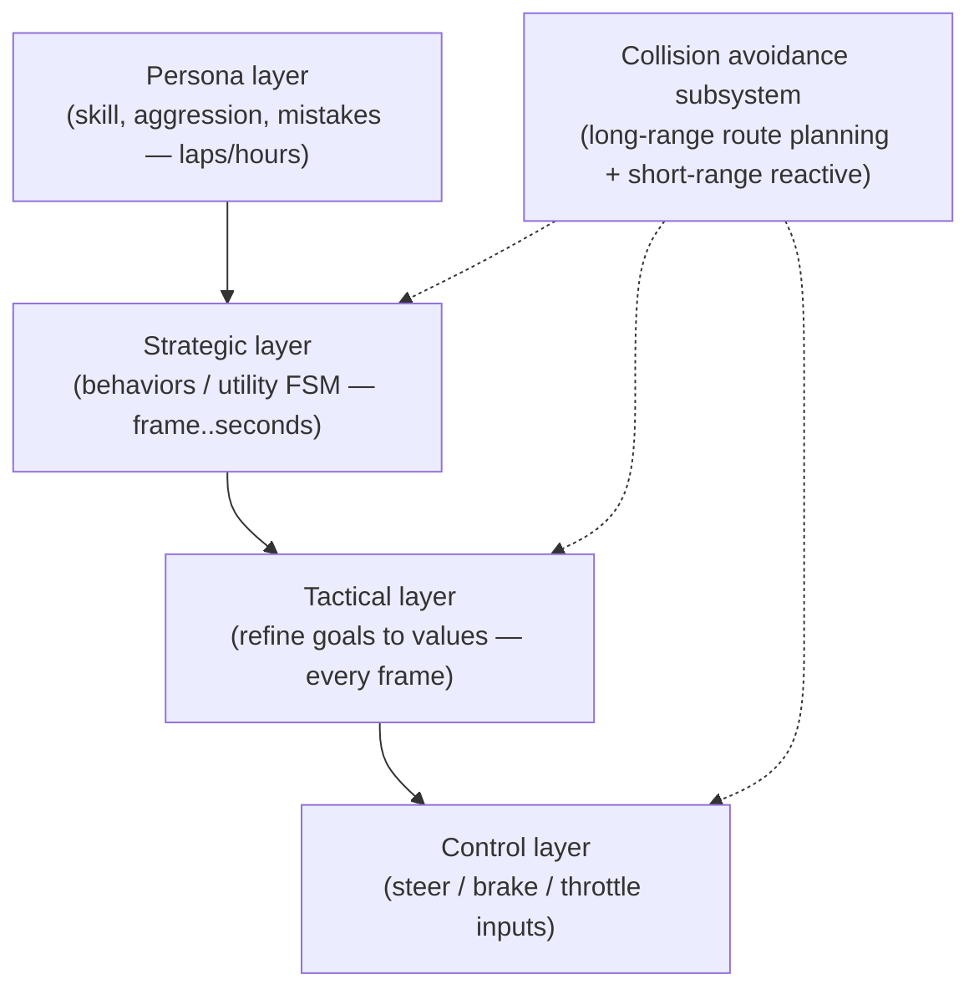

# Game AI Pro Ch. 38 — Racing AI Architecture — Research & `traf1` Gap Audit

> **Primary Sources:**
> - Simon Tomlinson & Nic Melder, **"An Architecture Overview for AI in Racing Games"**, *Game AI Pro*, CRC Press 2013, Ch. 38 (pp. 471–479) — [free official PDF](https://www.gameaipro.com/GameAIPro/GameAIPro_Chapter38_An_Architecture_Overview_for_AI_in_Racing_Games.pdf)
> - In-text references for follow-up threads: [Biasillo 02a–c] race-track representation / racing AI logic / training an AI to race (*AI Game Programming Wisdom*), [Jimenez 09] *The Pure Advantage: Advanced Racing Game AI*, [Melder 13] **"A Rubber-Banding System for Gameplay Race Management"** (*Game AI Pro*), [Pacejka 06] *Tyre and Vehicle Dynamics*.

---

## 1. The chapter in one paragraph

Racing AI is presented as **four layers plus one cross-cutting subsystem**: a long-timescale **persona layer** (driver skill), a **strategic layer** (behaviors, frame-to-seconds), a **tactical layer** (every-frame refinement), and a **control layer** (final steer/brake/throttle), with a **collision-avoidance subsystem** spanning all of them (long-range route planning + short-range reactive spacing). The whole design is geared toward driving *at the limit of tyre grip at all times* (§38.2). Behaviors are a **utility-scored FSM with hysteresis** (§38.5). A separate **race choreographer** scripts storyline events (§38.6), the AI should drive through the **same interface as the human** (§38.7), and balancing is split between AI-side skill spread and physics-side rubber-banding, with **offline genetic-algorithm optimization** as the tuning tool and a **human as final arbiter** (§38.8).

## 2. The architecture (§38.2–38.3)

- **Physics first (§38.2):** every acceleration (speed or direction) applies force through the tyres; exceeding grip causes slides (understeer/oversteer, wheelspin/lock). The AI's core job is to *never exceed available grip*, while working **as close to the limit as possible** — conservative AI is slow AI.
- **Layer timescales:** persona = whole-race/career; strategic = one frame to a few seconds; tactical = every frame; control = every frame, resolves *competing* goals into one input vector.
- **Collision avoidance (§38.3):** split by immediacy — long range (plan safe routes around debris/damaged cars several seconds ahead) and short range (rapid micro-adjustments: walls, side-by-side overtaking, slipstreaming).

## 3. Persona & skill mapping (§38.4)

| Concept | Chapter spec |
|---|---|
| Skill (primary) | Applied wherever speed is calculated (cornering speed, braking distances) as a **multiplier on available grip**. User/designer-facing range `[0, 100]` maps to a **narrow internal band, e.g. 98–99%** — a 1% delta compounds over laps into a visible spread. Easier difficulty = map lower (80–82%). |
| Biorhythm | Skill varies slowly in time (sine, ~100 s period — or a **low-duty square wave**: near-max ~90% of the time, dipping to 90–95% briefly) so drivers become **temporarily overtakable** without changing average pace. Extendable to a full race-pace system [Jimenez 09, Melder 13]. |
| Aggression (secondary) | Follows closer ahead, needs less space to attempt a pass. |
| Vehicle control (secondary) | e.g. takes 2× longer to apply throttle. |
| Mistakes (secondary) | Random errors in corner-speed calculation. |
| Why it matters | In a fixed formula (F1!), skill spread *is* the spread of cars on track — produces micro-challenges as the player progresses through the field. |

## 4. Racing behaviors — utility FSM with hysteresis (§38.5)

Every strategic update, **all valid behaviors score a utility**; a transition happens only if challenger > current **+ threshold** (hysteresis prevents flip-flopping). With a `[0, 1000]` range:

| Behavior | Utility & rules |
|---|---|
| **Normal Driving** (§38.5.1) | Baseline constant **500** — the bar all others must beat. Stay near the racing line, conservative spacing. |
| **Overtake** (§38.5.2) | Look ahead for opponents in range + own speed advantage; find a **safe window** across the track width. **Anticipation**: a car approaching a corner will slow (opportunity); an understeering car opens an inside gap. Randomness/biorhythm contributes to utility; less likely on straights (all at full throttle); **always** activate on a big advantage (opponent mechanical failure). While active: skill → saturation, avoidance tolerances reduced. **Abort** if the gap closes → **cooldown: no re-activation for a few seconds**. Don't return to Normal too early after success (speed dip → position lost back). |
| **Defend / Block** (§38.5.3) | Trigger: attacker behind, off-line, with current/future speed advantage. Small steering moves to **mirror the attacker's line**. F1: **one lateral move only** (no weaving). Abort if the opponent is endangered — opposing AI/player can **post a complaint message**. Push to the limit while defending. |
| **Branch** (§38.5.4) | Pit lane / route splits. Decide **early** enough to line up the branch entry; watch for blockers (brake to fall behind them); state persists until well into the branch. |
| **Recover** (§38.5.5) | Off-track / spun. **Integrate utility over seconds** so one bad frame doesn't trigger it — e.g. at 10 Hz strategic updates: +10 per metre off track, +10 per wheel without grip, **−20 per frame**; quickly drained once stable, on-track, facing the right way. Manners: yield to approaching cars, stay put until upstream is clear. |

## 5. Race choreographer, interfaces, balancing (§38.6–38.8)

- **Race choreographer (§38.6):** a separate AI object receiving event triggers from vehicles/physics/game code, acting at persona/strategic level. Examples: change a driver's skill mid-race, cause a tyre blowout, custom behaviors ("try to collide with the player"). This is the *storyline* hook.
- **Interfaces (§38.7):** the AI↔vehicle interface must be **identical to the human controller's** (interchangeable AI/human). AI also reads physics metrics (available grip, per-tyre slide). AI-to-AI intent queries ("are you about to turn left?") are legitimate — an expert driver reads opponents' intentions — but add **fuzziness/randomization** so it isn't perfect.
- **Balancing (§38.8):** two separate problems — (a) **spread of the AI group** (achieve the right distribution of performances) → do it in AI skill; (b) **overall balance vs the player** → do it in **physics** (tyre grip, engine power/torque), not by pushing AI past 100% grip (that creates mistakes that ruin the balance). **Rubber-banding** [Melder 13]: beat the player at the start, lose at the finish — player wins in the last few hundred metres. Account for AI running a cut-down physics model that diverges from the human's.
- **Offline learning (§38.8.1):** per-node bisection of the racing line kinks (false solutions: nodes aren't independent). Use a **modified genetic algorithm**: Monte Carlo base (√N faster than linear search in N variables), **crossover patching runs of nodes from two parents**, **coherent mutation of adjacent-node runs**, seeded with track knowledge (known curve groups, favorable patterns). Minimize parameter count (wider-spaced line nodes). **Always keep a manual editing fallback.** GA also fits utility weights and control-layer constants. **The final arbiter is a human** — lap-time-optimized AI can still be uncompetitive in traffic or too easy/hard to overtake.

---

## 6. Gap audit — `/drive` APEX GRID real-time AI

Scope: `static/js/f1_drive_ai.js` (19-car spatial AI director), `static/js/f1_drive_physics.js`.

| Chapter concept | Chapter spec | Current `traf1` status | Status |
|---|---|---|---|
| Physics understanding | §38.2 — drive at, never past, the grip limit | AI longitudinal model is calibrated to the player physics (`f1_drive_ai.js:2–20` header, powertrain + aero-drag model, DRS/override drag steps at `:396`) — but pace control is a **scalar speed/power multiplier** (`:57–58`, `:75` skill mult `0.94..1.03`), not a grip-circle/tyre-saturation model | **Partial** |
| Persona layer | §38.4 — per-driver skill/aggression/control/mistakes | One **global** `ai_difficulty` knob, default 78%, clamped 50–105% (`:53`) applied identically to all 19 AI | **Missing** (per-driver DNA exists Python-side, not wired into the drive AI) |
| Skill biorhythm | §38.4 — temporary vulnerability windows | None | **Missing** |
| Strategic layer (behaviors) | §38.3/38.5 — utility FSM of behaviors | Decisions are immediate IDM lane-change choices (`:11`, `:371`); no behavior states, no utility, no hysteresis | **Missing** |
| Tactical layer | §38.3 — every-frame refinement | **Intelligent Driver Model** safe headway + lateral planner with 78 m lookahead sampling (`:300`, `:371`) | **Implemented** (closest analog) |
| Control layer | §38.3 — combined throttle/brake/steer | Physics-matched powertrain → inputs per tick | **Implemented** |
| Collision avoidance — long range | §38.3 — plan around debris/damaged cars | 20-car spatial lookahead includes slow/stalled starters (hard braking when boxed in) but no damaged-car route planning | **Partial** |
| Collision avoidance — short range | §38.3 — walls, side-by-side, slipstream | 2D **OBB anti-clipping solver** (5.65 m × 2.25 m) for AI-vs-player *and* AI-vs-AI (`:454`, `:492`) | **Implemented** |
| Overtake anticipation | §38.5.2 — predict corner-entry slowdowns, understeer gaps | Proximity/speed checks are instantaneous; no braking-zone or tyre-cliff prediction | **Missing** |
| Overtake abort + cooldown | §38.5.2 — abort on closing gap, no re-attempt for seconds | Not modeled | **Missing** |
| Defend/Block + FIA one-move rule | §38.5.3 — mirror the attacker, one lateral move, complaint abort | `/drive` AI never defends (full_sim stewards do moved-under-braking verdicts, but that's the stat sim) | **Missing** |
| Recover | §38.5.5 — stabilize, yield, rejoin with manners | Not present in the AI director (header scope: spacing/overtaking/anti-clipping/ghost) | **Missing** |
| Interface parity | §38.7 — AI drives through the same interface as the human | Explicit design goal: "Physics-Matched … calibrated to `f1_drive_physics.js`" | **Implemented** |
| AI-to-AI intent queries | §38.7 — shared intent with fuzziness | All cars live in one controller (state is already shared) but no intent protocol/fuzz | **N/A / Missing** |
| Rubber-banding | §38.8 — choreographed pace vs player | Deliberately absent (skill-based difficulty slider only) | **Missing (design choice — keep?)** |

## 7. Gap audit — stat-sim engines

Scope: `static/js/f1_race_engine.js` (shared engine for `/play`, `/sim`, `/career`), `full_sim.js` (`/sim` broadcast), `track_sim.js`, `ladder_race_sim.js`, `weekend_session_sim.js`, `f1data/driver_dna.py`, `f1data/era_rules.py`, `f1data/ladder_engine.py`.

| Chapter concept | Chapter spec | Current `traf1` status | Status |
|---|---|---|---|
| Persona layer | §38.4 | `driver_dna.py` — data-deduced DNA for all drivers 1950–2026 (wet/street propensity, cornering geometry V/U-line, launch reactions, radio archetypes); `f1_race_engine.js:157–176` seeds per-race confidence (38–88 from composure/setup/affinity) and momentum | **Implemented** |
| Skill biorhythm | §38.4 — slow skill wave creating overtakable windows | Confidence moves **only via events** (`applyPsychologyEvent`, `:199+`; overtake +5.5 conf/+18 mom); no intrinsic time-based skill wave → races settle into pace order | **Missing** |
| Strategic behaviors (utility FSM) | §38.5 — competing utilities + hysteresis | `full_sim.js:642–700` is a **proto-FSM**: `riskMode` (low/std/high via RISK table `f1_race_engine.js:45–47`), `paceMode`/`aiStatus` (SC DELTA, COOLING PU, SAVING TYRES, ATTACKING/DEFENDING/FINAL PUSH, MANAGING GAP), ERS harvest/deploy — all threshold-selected each tick, **no utility scores, no hysteresis, no post-abort cooldown** | **Partial** |
| Overtake anticipation | §38.5.2 | Gap thresholds only (`gapAhead < atkThresh`, `:652`, `:667`); `undercutPushLaps` is strategy-level anticipation; no "leader enters braking zone / tyre cliff" prediction | **Partial** |
| Defend/Block | §38.5.3 | `🛡 ERS DEFEND` mode + DEFENDING status exist (`:671`, `:692`); stewards announce moved-under-braking (`:375`) — but the FIA **one-move** constraint isn't a modeled behavior (also flagged in `docs/fia_rules_research.md` §2.3) | **Partial** |
| Branch (pit lane) | §38.5.4 — decide early, persist | Pit windows, undercut/overcut bursts, rejoin-ghost predictor (`ladder_race_sim.js` header), SC-cheap-stop prediction (`track_sim.js:668–672`) | **Implemented** |
| Recover | §38.5.5 | `wingDamaged` → conserve posture + meatball-adjacent handling; DNF states; no spin/off-track recovery *behavior* with integrated utility | **Partial** |
| Race choreographer | §38.6 — per-driver storyline scripting | **Global** Race Control only: DRS-on-lap-2, VSC/SC, sector yellows (`track_sim.js:727`, `:398`), physical pace car (`:217–226`). No per-driver interventions (mid-race form swing, tyre blowout at a chosen moment, "attack Px" directives) | **Partial** |
| Interface parity | §38.7 | N/A — stat sims have no shared controller interface by design | **N/A** |
| AI-to-AI intent | §38.7 | Not modeled (could cheaply de-mechanize battles between the TV-director's battle pairs, `full_sim.js:707–724`) | **Missing** |
| Balancing / rubber-banding | §38.8 + [Melder 13] | Ladder difficulty is static per tier (`ladder_engine.py:1452` `quick_sim_race`); drive difficulty is a static slider. No race-time pace management vs the player | **Missing** |
| Offline learning (GA tuning) | §38.8.1 | `performance_balance.py` / `rating_engine.py` hold hand-tuned constants; no automated lap-time/utility-weight optimization | **Missing** (low priority) |

## 8. Prioritized adoption roadmap (drama-per-effort order)

1. **Skill biorhythm in persona init** — `f1_race_engine.js` `initDriverPsychology`: per-driver slow wave (sine ~60–120 s or low-duty square) scaled ±0.3–0.6% by DNA composure, applied to the pace model. *Effort S.* Payoff: organic lead changes + radio/interviews drama in `/sim`, `/play`, `/career` without touching difficulty.
2. **Utility-FSM battle states with hysteresis** — formalize ATTACKING/DEFENDING/MANAGING into states with utility scores + hysteresis threshold + **attack-abort cooldown** (no re-attack for N laps). Utility inputs: gap, pace delta, tyre delta/age, ERS/DRS availability, tyre-cliff proximity, confidence tier. Replaces the scattered gap-threshold ifs at `full_sim.js:642–700`. *Effort M.*
3. **Overtake anticipation hook** — on top of #2: raise overtake utility when the leader approaches a heavy-braking zone (curvature ahead) or an old tyre stint enters the cliff — exactly §38.5.2's anticipation examples. *Effort S–M.*
4. **Defend/Block + FIA one-move rule** — defender commits one lateral line per straight; attacker "complaint" aborts dangerous squeezes; feeds the existing stewards/moved-under-braking vocabulary (`full_sim.js:375`) and closes the matching gap in `docs/fia_rules_research.md` §2.3. *Effort M.*
5. **Race choreographer module** — event-bus + scripted per-driver interventions (mid-race form swing, tyre blowout, target-a-driver directives); integrates with Race Control, commentary (`:364–377`), and `interviews.py` event vocabulary. *Effort M.*
6. **Per-driver persona in `/drive`** — thread DNA traits through the drive session config so each of the 19 AI gets skill/aggression multipliers (aggression = IDM headway + lane-change tolerance scaling) instead of one global difficulty. *Effort M.*
7. **Recovery states in `/drive`** — off-track/spin behavior with §38.5.5's integrated utility (+off-track metres, −per-frame decay) and stay-put manners. *Effort S–M.*
8. **Rubber-banding for the Ladder** — defer; read [Melder 13] first and decide whether the Ladder *wants* pace management or pure tier-gating. *Effort M, decision needed.*

**Not recommended:** GA offline tuning of racing lines (§38.8.1) — no spline racing line exists in traf1; if GA is ever used, target utility weights / pace constants (#2's table), keeping manual values as fallback.

## 9. Follow-up reading threads

- **[Melder 13]** "A Rubber-Banding System for Gameplay Race Management" (*Game AI Pro*) — direct prerequisite for roadmap #8; same author as this chapter.
- **[Biasillo 02a–c]** race-track representation, racing AI logic, training an AI to race — the classic three-part foundation the chapter builds on.
- **[Jimenez 09]** "The Pure Advantage: Advanced Racing Game AI" — race-pace system (biorhythm extension).
- gameaipro.com hosts the full book free per-chapter; the Racing section (Part VI) continues where Ch. 38 stops.
